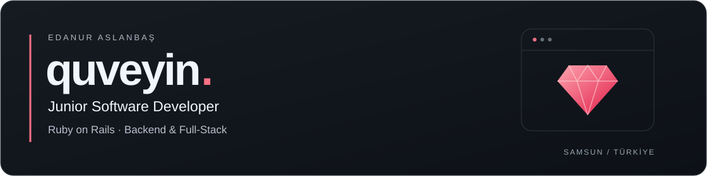

  

  <a href="https://github.com/quveyin?tab=repositories">Projelerim</a> ·
  <a href="https://www.linkedin.com/in/edanur-aslanba%C5%9F/">LinkedIn</a> ·
  <a href="mailto:edanuraslanbas7@gmail.com">E-posta</a>

## Merhaba, ben Edanur.

Ruby ve **Ruby on Rails** ile web uygulamaları geliştiriyorum. Backend ve full-stack alanlarında ilerliyor; veri modelleri, kullanıcı oturumları, uygulama akışları ve servis entegrasyonları üzerinde çalışıyorum.

Ondokuz Mayıs Üniversitesinde Arka-Yüz Yazılım Geliştirme eğitimi aldım. Global Media stajımda Ruby, Rails, veri tabanı ve web arayüzü geliştirme çalışmalarına katıldım. Kendi projelerimde öğrendiklerimi çalışan uygulamalara dönüştürüyorum.

## Seçili projeler

### [TracePaw](https://github.com/quveyin/tracepaw)
**Bireysel bitirme projem · Kayıp hayvan eşleştirme**

Kayıp ve bulunan hayvan kayıtlarını fotoğrafları üzerinden karşılaştıran bir web uygulaması geliştirdim. Rails uygulamasını Python tabanlı görsel analizle birleştirdim; hazır YOLO/CLIP modelleri ve pgvector ile görsel benzerlik sıralaması üzerinde çalıştım.

`Ruby on Rails` `Python` `PostgreSQL` `pgvector`

### [TodoApp](https://github.com/quveyin/todo_app)
**Bireysel proje · Kullanıcıya özel görev yönetimi**

Kullanıcı hesabı ve oturum yönetimi, görev oluşturma, güncelleme, silme ve tamamlanma durumuna göre filtreleme içeren bir Rails uygulaması geliştirdim.

`Ruby on Rails` `Active Record` `PostgreSQL` `HTML / CSS`

### [Wordle](https://github.com/quveyin/wordle_api)
**Bireysel proje · Kelime tahmin oyunu**

Ruby ile başladığım kelime oyununu Rails tabanlı bir web uygulamasına taşıdım. Tahmin doğrulama, harf eşleştirme, oyun durumu ve kullanıcıya geri bildirim akışları üzerinde çalıştım.

`Ruby` `Ruby on Rails` `Oyun mantığı` `Web arayüzü`

### [IndustrialSense](https://github.com/KeremOzcn/industrialsense-iot-monitoring)
**Ortak geliştirme · IoT izleme ve anomali tespiti**

Gerçek ölçüm cihazlarıyla yürüttüğümüz projede Java backend tarafında görev aldım. Spring Boot tabanlı sistem; sensör verilerinin alınmasını, saklanmasını ve REST API’ler üzerinden sunulmasını kapsıyor.

`Java` `Spring Boot` `REST API` `Spring Data JPA`

## Kullandığım teknolojiler

- **Ana odağım:** Ruby, Ruby on Rails, MVC, Active Record
- **Backend ve veri:** REST / JSON, kullanıcı oturumları, veri doğrulama, PostgreSQL
- **Web arayüzü:** HTML, CSS, JavaScript
- **Diğer proje çalışmalarım:** Python, Java, Spring Boot
- **Araçlar:** Git, GitHub

## Eğitimlerle desteklediğim alanlar

BTK Akademi’de aşağıdaki eğitimleri tamamladım. Java/Spring, API geliştirme, tasarım desenleri, mikroservis temelleri ve React bilgimi proje çalışmalarımda geliştirmeye devam ediyorum.

Tamamladığım BTK Akademi eğitimleri

- [İleri Seviye Java](https://www.btkakademi.gov.tr/portal/course/ileri-seviye-java-9353)
- [Mikroservis Mimarisine Giriş](https://www.btkakademi.gov.tr/portal/course/mikroservis-mimarisine-giris-66423)
- [Yazılım Tasarım Desenleri](https://www.btkakademi.gov.tr/portal/course/yazilim-tasarim-desenleri-12150)
- [Python ile Web API Geliştirme Atölyesi](https://www.btkakademi.gov.tr/portal/course/python-ile-web-api-gelistirme-atolyesi-59515)
- [React ile Web Uygulama Geliştirme](https://www.btkakademi.gov.tr/portal/course/react-ile-web-uygulama-gelistirme-61307)

---

**Samsun’da backend ve full-stack odaklı yazılım geliştirme ve ücretli staj fırsatlarına açığım.**
Birlikte çalışmak için [LinkedIn](https://www.linkedin.com/in/edanur-aslanba%C5%9F/) veya [e-posta](mailto:edanuraslanbas7@gmail.com) üzerinden ulaşabilirsiniz.
